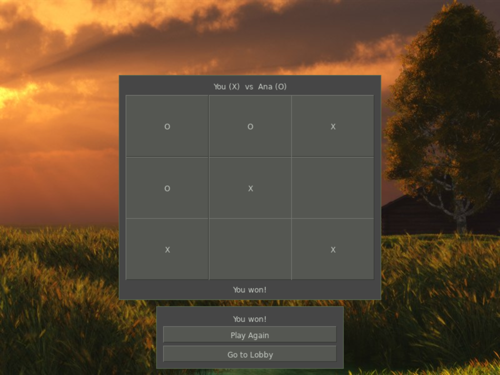

# tictactoe
Tic Tac Toe online game using SFML, SFGUI and kazilib (enet and its packet layer)

**Play it in your browser: https://kazin.dev/projects/tictactoe/**



## Libraries

| Library | Version | Where |
|---------|---------|-------|
| kazilib | master (submodule) | `src/dep/kazilib`: enet 1.3.18, `net/packet.h` / `net/socket.h`, `scene/manager.h` (the scenes), `text/utf8.h` (names), Testerino (`testerino/tcore.h`, `tserver.h`, `tt.js`), `stdnames.h`, `initflags.h`, magic_enum (built as its `ml` version through `kazilib.vcxproj`) |
| SFML | 3.1.0 x86 | `src/dep/SFML-3.1.0`: a junction to `D:\code\kazilib\SFML-3.1.0`, or the official vc17 32-bit release |
| SFGUI | 1.0.1 (submodule) | `src/dep/SFGUI`, built by CMake into `src/dep/SFGUI-1.0.1` |

## Building

Visual Studio 2026 (v145 toolset), CMake 3.22+ (for SFGUI). FASTBuild v1.20 is found
next to the checkouts or downloaded once.

```
git clone --recurse-submodules https://github.com/xkazinx/tictactoe.git
powershell -ExecutionPolicy Bypass -File build.ps1
```

`build.ps1` runs `setup.ps1` (submodules, SFML, SFGUI), then kazilib's FASTBuild runner
(`src\dep\kazilib\fastbuild\`) on `src\fastbuild.json`: Release, x86, with the 64-bit-hosted
compiler and linker, distributed to the workers that answer (MSBuild when FASTBuild is
missing). The FASTBuild config is generated from the `.vcxproj` files. Output: the server
`server\tictactoe_server.exe`, the client `deploy\tictactoe.exe` with its DLLs.
`build.ps1 client` / `server` builds one; `-Configuration Debug` builds Debug (only when needed).
Visual Studio builds the same thing from `src\tictactoe.sln`.

## Testing

Two kinds of tests, both from the checkout's root:

- **Protocol** (headless, no windows): `src\tests\run_protocol_test.cmd` builds
  `src\tests\protocol_test.cpp`, starts the server, plays two clients on kazilib's
  socket through log in, a taken name, a missing player, a win, the rematch, a
  draw, Go to Lobby and a disconnect, and stops the server. Exit code: failures.
- **The windows, through Testerino** (kazilib's test bridge,
  `src\dep\kazilib\testerino\README.md`): the client takes `testerino=<slot>`, the
  server `testerino`, only in a source checkout (`src\tictactoe.sln`). Routines in
  `src\tests\testerino\` start a server on port 6990 and the clients behind your
  windows (`background`), press the real widgets, type, check the answers and take
  screenshots:

  ```
  node src\dep\kazilib\testerino\tt.js run src\tests\testerino\login.tt
  node src\dep\kazilib\testerino\tt.js run src\tests\testerino\game.tt
  node src\dep\kazilib\testerino\tt.js run src\tests\testerino\disconnect.tt
  node src\dep\kazilib\testerino\tt.js run src\tests\testerino\lobby_widgets.tt
  ```

  Reports in `testerino\reports\`, screenshots in `testerino\client_<slot>\shots\`.
  Client verbs: `state`, `widgets`, `press <id | button text>`, `click x y`,
  `type`, `key`, `shot`, `close`, `quit`; conditions for `waitfor`: `window=`,
  `msg~`, `end~`, `board=`, `turn=`, `name=`, `players~`. Server verbs: `players`,
  `board <name>`, `kick <name>`, `quit`; conditions `players=`, `in_game=`.
  `help` on either lists them.

## Running

Start `server\tictactoe_server.exe`, then `deploy\tictactoe.exe` (run from `deploy\`, it
reads `fonts\comic.ttf`) twice, log in with two names (Enter logs in) and pick the
other player in the lobby; players in a game are marked. The one who picks plays X
and starts. After a game, Play Again on both starts a rematch (the other is told),
Go to Lobby ends it (the other is told too).
The server address is `127.0.0.1:6987` by default: `tictactoe.exe ip=<host> port=<n>`
(the server takes `port=<n>`), or an `init.json` next to the exe (`{"ip": "1.2.3.4"}`).
`title=<text>` names a client's window; `background` opens it behind the others.

## In a web browser

Play at **https://kazin.dev/projects/tictactoe/**. The same client compiled to
WebAssembly (Emscripten) plays against the same server as the Windows clients.

- **SFML 3.1 and SFGUI 1.0.1 for the web**: kazilib's patches
  (`src\dep\kazilib\web\`, its README). SFML's window runs on SDL3, and its OpenGL ES 1
  drawing is emulated on WebGL2. SFGUI's shader renderer runs on WebGL2.
- **The network**: the client keeps its ENet code. In a browser, kazilib's
  `enet/websocket.cpp` carries it over one WebSocket. The server exe has a WebSocket
  gateway (kazilib `net/ws_gateway.h`, its own thread) that hands each browser to the
  server as an ordinary ENet peer on loopback. Flags: `ws=<port>` (default the game
  port + 1, `0` = off), `ws_bind=<address>` (default `127.0.0.1`), `web=<folder>`
  (files it serves on the same port; default the exe's `web\` folder).
- **Launch flags in a browser**: the page's query string, e.g. `?title=2` or
  `?ws=wss://host/path/ws`. By default the WebSocket is the page's folder + `ws`.
- **Scaled Window** (the default), **Original Size** (the choice remembered, or
  `?scale=fit` / `?scale=fixed`) and **Fullscreen**, under the game: the 800x600 game
  scaled, its aspect kept (kazilib `web/shell.html`).

```
powershell -ExecutionPolicy Bypass -File build_web.ps1
```

`build_web.ps1` builds SFML / SFGUI for the web once (Emscripten from
`D:\code\tools\emsdk`, installed when missing), then the client from
`src\client\CMakeLists.txt`, and copies it to `server\web\`. Start
`server\tictactoe_server.exe` and open http://127.0.0.1:6988/.
Test: `src\tests\web\run_web_test.ps1` plays two headless browser tabs through a game
(`-Url https://kazin.dev/projects/tictactoe/` for the live one).

## Linux server and the deployment

```
powershell -ExecutionPolicy Bypass -File build_linux.ps1     # src\build\linux\tictactoe_server
powershell -ExecutionPolicy Bypass -File deploy_ubuntu.ps1   # both builds, upload, install
```

The Linux server is built here in a Docker container of Ubuntu 26.04, the box's
system, from `src\server\CMakeLists.txt`. `deploy_ubuntu.ps1` sends it and the web
build to the box `kazin-music` with `deploy\ubuntu\`, and installs them:

- `/opt/tictactoe/bin/tictactoe_server`, run as the systemd service `tictactoe`
  (user `tictactoe`), ENet on UDP 6987 and the gateway on 127.0.0.1:6988.
- `/opt/tictactoe/web`, served by Caddy: `/etc/caddy/sites/kazin.dev.d/tictactoe.caddy`.
- Logs: `journalctl -u tictactoe` (one line per browser connection opened or closed, with why).

UDP 6987 is closed by the box's firewall, so native clients can't reach the live
server yet.

---

## Original README (2016-06-19, commit 628af25)

The README as its author wrote it, kept word for word under the new one:

# tictactoe
Tic Tac Toe online game using SFML, SFGUI and ENet
